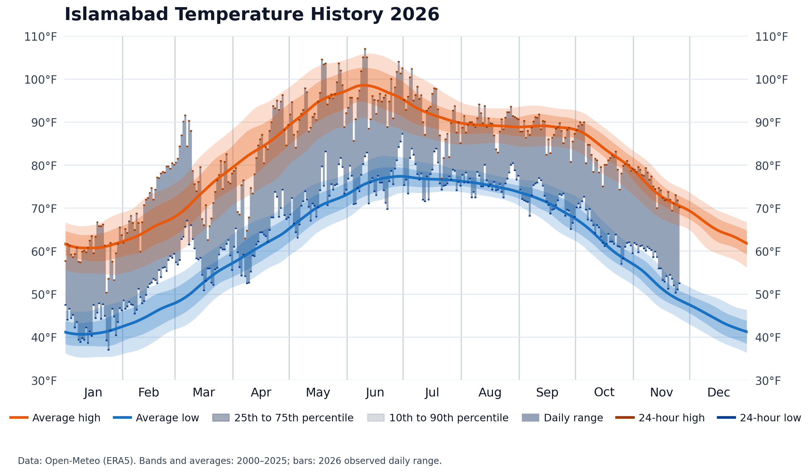

<div align="center">

# 🌡️ Islamabad Temperature History

**A year of weather, in context of twenty-five.**

[](https://python.org)
[](https://pandas.pydata.org)
[](https://matplotlib.org)
[](https://scipy.org)
[](https://open-meteo.com)
[](LICENSE)

</div>

---

<div align="center">



</div>

---

## ✨ What you're looking at

A single chart that answers the question every weather conversation eventually asks:

> *"Is this normal?"*

Every day of the year sits on the x-axis. The **orange and blue curves** are the
long-term climatological averages of daily high and low temperatures. The **shaded
bands** around them are percentile envelopes — the inner band is the middle 50% of
past years, the outer band the middle 80%. The **slate bars** are this year's
observed daily high–low range, with dark ticks marking the exact 24-hour extremes
inside each bar.

If the bars stay inside the inner band, it was a typical year. If they poke out past
the outer band, that day was unusual.

---

## 🔍 The anatomy of the chart

| Element | Meaning |
| :--- | :--- |
| 🟠 **Solid orange line** | Average daily high, `2000 → present-1` |
| 🔵 **Solid blue line** | Average daily low, `2000 → present-1` |
| 🟠 **Outer orange band** | 10th–90th percentile of daily highs |
| 🟠 **Inner orange band** | 25th–75th percentile of daily highs |
| 🔵 **Outer blue band** | 10th–90th percentile of daily lows |
| 🔵 **Inner blue band** | 25th–75th percentile of daily lows |
| ⬜ **Slate bars** | Observed daily high–low range, current year |
| ⬛ **Dark ticks** | 24-hour high (orange) / low (blue) inside each bar |

---

## ⚙️ Under the hood

**Data sources**

- **Climatology** → Open-Meteo Archive API (ERA5), daily `temperature_2m_max/min`
  for **2000 → last completed year**.
- **Observed** → the current year's daily highs and lows, stitched from the
  **Archive API** up to `today − 6 days` (ERA5 lag) plus the **Forecast API** with
  `past_days=10` to fill the gap.

**The percentile trick**

For each day of year `d ∈ [1, 365]`, values are pooled across every historical year
within `d ± 7` days. From that pool: mean, 10th, 25th, 75th, and 90th percentiles
are taken, then smoothed with a `gaussian_filter1d(σ = 3, mode="wrap")` so the
day-365 → day-1 seam stays continuous.

```python
window = np.concatenate([np.roll(m, k, axis=1) for k in range(-7, 8)])
p10, p25, p75, p90 = np.nanpercentile(window, [10, 25, 75, 90], axis=0)
